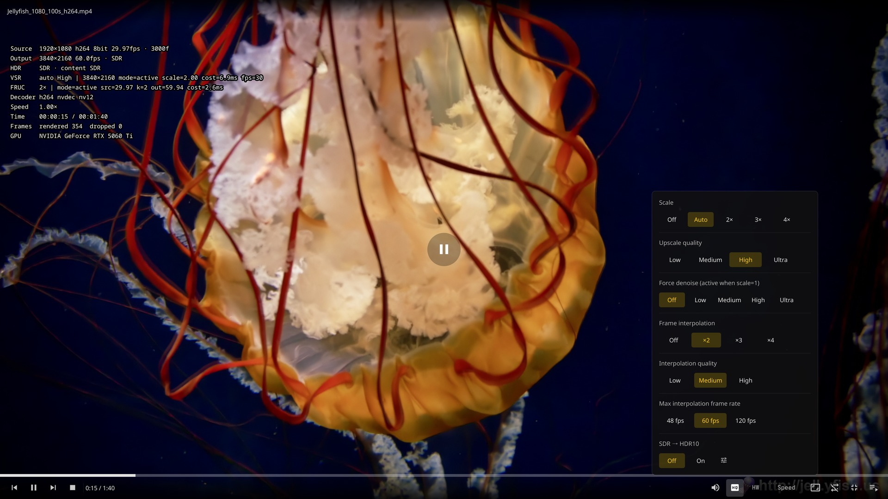
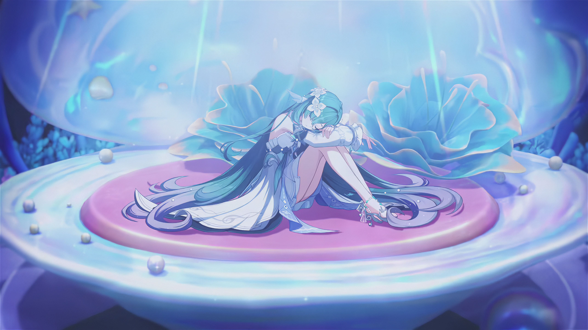

<p align="center">
  
</p>

# VSR Player

[](https://github.com/zhangmq/vsr-player/releases)
[](LICENSE)

Real-time AI video processing player for Linux, built directly on the **NVIDIA Video
Effects SDK**: neural super-resolution + denoising, frame interpolation, and a 10-bit HDR
pipeline with HDR10 output and SDR→HDR10 upconversion. Built on **libmpv** (demux, decode,
A/V sync, VO all handled by mpv) with a Qt 6 / QML frontend on a Vulkan device shared with
mpv.

> NVIDIA's driver-level RTX Video Super Resolution has no Linux interface. The Video Effects
> SDK exposes the same models with a Linux runtime, so this project calls its C API directly
> from a player. That is a workaround, not the ideal place for this kind of processing — it
> exists because there is no driver-level path on Linux.

## What it does

- **AI super-resolution + denoise** — real-time 2×/3×/4× (`vf_vsr`); denoise also works at scale=1
- **AI frame interpolation** — VFX `VideoFrameGeneration` ×2/×3/×4, quality hot-switchable (`vf_vfg`)
- **10-bit / HDR end to end** — RGB10A2 through the whole chain, automatic HDR10 output for HDR content, opt-in SDR→HDR10 upconversion (`vf_truehdr`)
- **3D on XR glasses** (headline feature) — play 3D videos (side-by-side or top-and-bottom) on XR glasses in 3D mode: fullscreen picture on the glasses, controls stay on the desktop
- **2D output** — watch one eye of a 3D source as a normal full-frame picture, with VSR applied per eye (`vf_eye`)
- **Blu-ray ISO (2D titles)** — `.iso` behaves like a folder or m3u: titles are listed with names and durations, nothing auto-plays. 3D Blu-ray (MVC) is out of scope: convert to SBS offline first
- **Hover thumbnails** — the progress bar previews the frame under the pointer, with the time and the chapter name; works for local files and for network streams
- **Everyday player** — NVDEC decode, Vulkan rendering, auto-hide QML UI, playlist, tracks and delay control, loop modes, speed, screenshots, JSON IPC, standalone `mpv-vsr` CLI

## Pipeline

```
demux → decode → [deint] → [hwup] → [eye] → [rot]
      → [vsr] → [truehdr] → [vfg] → VO (libmpv) → Qt scene graph
```

Each bracket is a filter of this project (mpv's own pipeline handles everything else). The
order is a cost decision, not a matter of taste: software-decoded frames are uploaded to CUDA
once at the front, upscaling runs **once per source frame** on the small picture, and
interpolation runs last on the finished picture — everything placed after interpolation would
be billed ×2/×3/×4.

## What's new

**0.7.2**

- **Fixed: the player would not start after a system update** — sndio 1.11.0 renamed its
  library (`libsndio.so.7` → `libsndio.so.9`), so the dynamic loader aborted before the
  player could run. The `full` package now carries `libsndio`.
- **Clearer dependency failures** — alongside the existing `COMPONENTS.md` table, the
  package now ships `lib/vsr-player/deps.manifest` (one line per required SONAME, which
  binary needs it, and the build-machine path). `install.sh` verifies it and lists *every*
  missing entry with its owner, instead of the previous five raw loader lines whose text
  only mentioned FFmpeg/CUDA/Qt.

**0.7.1**

- **Fixed: picture freezes on the first fullscreen switch** — video and audio keep
  running but the picture stops updating until the window is resized or fullscreen
  is left. Caused by a Qt 6.12.0 defect on the Vulkan + Wayland path (upstream
  QTBUG-151831, fixed in 6.12.1); this package ships the fixed Qt library and
  enables it only when your host Qt needs it.
- **Fixed: closing the player leaves the process (and the terminal) behind** —
  same driver trigger, a second Qt 6.12.0 defect (upstream QTBUG-150279, fixed in
  6.12.1). This package ships that fix as well.

**0.7.0**

- **Hover thumbnails** — hovering the progress bar shows a thumbnail of that position, 192
  logical pixels wide and rendered at the display scale, so it stays sharp on HiDPI. Local
  files and network streams alike (the address and headers already resolved are reused, so
  no second extraction); a failed fetch is retried on the next hover. Switch it off in the
  menu: **Interface → Thumbnails**.
- **About** — the right-click menu ends with **About**: icon, program name, version, licence
  and a clickable repository link.
- **New application icon** — transparent background, pixel tiles fading into a sharp
  triangle; it is the launcher/taskbar icon and the one the About dialog shows.

**0.6.0**

- **The right-click menu is the control centre** — video/audio/subtitle tracks, network
  stream selection, subtitle and audio delay, alongside the picture-processing and 3D
  blocks; fully keyboard-driven.
- **One key map** — every shortcut lives in a single table, so 2D playback, 3D presentation
  and menu navigation cannot drift apart.

## Screenshots

<p align="center">
  
</p>

**VSR comparison** — original 720p (left) and the same frame at 4× (right):

<p align="center">
  
  
</p>

## Quick start

**Source build** (recommended — the binaries match your system libraries by construction):

```bash
git clone https://github.com/zhangmq/vsr-player && cd vsr-player
# prepare third_party/ first: see docs/third-party-setup.md
./scripts/build-from-source.sh
```

**Prebuilt tarball** — `standard` is a **thin package (~13 MB)**: it ships the players,
libmpv, the two Wayland helper modules, the two patched Qt libraries and a machine-readable
dependency manifest. FFmpeg, the media stack, CUDA, libplacebo and **Qt ≥ 6.12** come from
your system (VFX is downloaded at install time), and `install.sh` refuses to install when
the system cannot satisfy a manifest entry — naming the missing library and what needs it:

```bash
tar -xJf vsr-player-<ver>-linux-x86_64.tar.xz
./install.sh                 # installs into ~/.local, no sudo
```

Both install a **VSR Player** launcher entry and can be used as the default video/audio
handler. Packaging variants, manual builds and version compatibility:
[wiki: Installation](https://github.com/zhangmq/vsr-player/wiki/Installation).

## Requirements

| | Minimum | Notes |
|---|---|---|
| GPU | RTX 20-series | VSR needs RTX 20+; the default interpolation backend needs **Ada/Blackwell** (Ampere+ for the frozen RIFE source build) |
| Driver | 570+ | Wayland works out of the box |
| VFX SDK | 1.3 (`nvidia-vfx` 0.2.0.0) | `install.sh` fetches it from NVIDIA's index, never into a Python environment |
| Qt | 6.12+ | Otherwise build the `full` variant yourself |

## Playing

```bash
vsr-player video.mkv            # file
vsr-player ~/Videos             # directory → playlist
vsr-player                      # restore the last playlist, load nothing until Play
```

| Key | Action |
|---|---|
| `Space` | Play / pause |
| `←` / `→` | Seek ∓5 s (`Shift` = ±10 s) |
| `↑` / `↓` | Volume ±5 % |
| `Ctrl+←` / `Ctrl+→` | Previous / next playlist entry |
| `A` / `Shift+A` | Cycle aspect ratio forward / backward |
| `V` | Subtitles on / off |
| `,` / `.` | Step one frame back / forward |
| `P` / `F` / `Tab` / `S` | Playlist · fullscreen · OSD · screenshot |
| `Delete` / `Shift+Delete` | Remove the current entry / move the file to trash |
| `Menu` / `F10` | Right-click menu (keyboard-navigable) |
| `Ctrl+Q` | Quit |
| `J` / `K` / `L` | 3D or single-eye mode: layout · eye order · full/half |

The right-click menu holds the rest — tracks and network streams, subtitle/audio delay,
**Picture processing** (deinterlace, rotation), 3D and **About**. Every option, the JSON IPC
commands and the standalone `mpv-vsr` CLI: [wiki: Usage](https://github.com/zhangmq/vsr-player/wiki/Usage).

## Documentation

- **Wiki** — [Installation](https://github.com/zhangmq/vsr-player/wiki/Installation) ·
  [Usage](https://github.com/zhangmq/vsr-player/wiki/Usage) ·
  [Video Processing](https://github.com/zhangmq/vsr-player/wiki/Video-Processing) ·
  [3D and Single-Eye](https://github.com/zhangmq/vsr-player/wiki/3D-and-Single-Eye) ·
  [Blu-ray and Playlists](https://github.com/zhangmq/vsr-player/wiki/Blu-ray-and-Playlists) ·
  [Troubleshooting](https://github.com/zhangmq/vsr-player/wiki/Troubleshooting) ·
  [Development](https://github.com/zhangmq/vsr-player/wiki/Development)
- [`docs/`](docs) — engineering notes and measurements (HDR pipeline, VFX SDK, TrueHDR, 3D conversion, …)
- [`docs/third-party-setup.md`](docs/third-party-setup.md) — preparing `third_party/` for source builds

## Status & scope

The video-processing side is feature-complete for its intended scope. Everything else —
window chrome, control layout, hover behaviour, OSD wording — reflects the author's
preference rather than a specification and may change at any time; this README is not a
roadmap.

Development happens on a single GPU generation and a small set of test files, so rough edges
are expected: crashes, artifacts or hangs that were never seen here can still happen on other
combinations. Bug reports and pull requests are welcome. The repository is deliberately
agent-friendly — an AI coding agent can read the pipeline, the mpv patch overlay and the
design records in `docs/` to locate issues quickly.

## License

GPLv2+. The project compiles a patched mpv and links against libmpv, so distributed binaries
are derivative works of mpv and are distributed under the same license. The NVIDIA Video
Effects SDK runtime is NVIDIA proprietary software and is not covered by this project's
license. See [LICENSE](LICENSE).

---

[中文版](README_zh.md)
