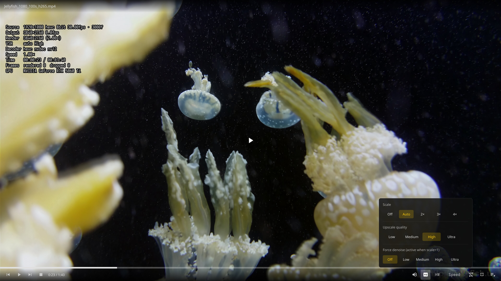

# VSR Player

Real-time AI video processing player for Linux, built directly on the NVIDIA Video Effects SDK: neural **super-resolution + denoising**, **frame interpolation**, and **HDR** (10-bit RGB10A2 pipeline, HDR10 output, SDR→HDR10 upconversion).

Built on **libmpv** — demux, decode, A/V sync, timing, and VO rendering are handled by mpv. The AI stages are injected as custom mpv video filters (`vf_vsr`, `vf_vfg`, `vf_truehdr`), which run on CUDA and feed their results back into the mpv pipeline. The frontend is a Qt 6 + QML client (Vulkan, shared device with mpv).

## Background

NVIDIA RTX Video Super Resolution (RTX VSR) has been available on Windows for some time, integrated through the driver and supported by browsers and media players. On Linux, however, this driver-level interface is not exposed, and mainstream players (mpv, VLC, etc.) currently have no way to use RTX VSR.

The NVIDIA Video Effects SDK provides access to the same underlying AI models and does offer a Linux version, but it is not a straightforward dependency — it ships as an Early Access SDK with a substantial inference runtime (~1 GB), and there is no established integration path into existing players.

This project calls the Video Effects SDK C API directly from a player. This is not an ideal approach — processing of this kind belongs at the driver or compositor level — and exists only as a workaround until the driver-level VSR interface becomes available on Linux.

## Video Processing (NVIDIA Video Effects SDK)

The three VFX SDK capabilities this project set out to cover are all wired in, and they compose into a single GPU filter chain:

- **AI Super-Resolution + Denoising** — real-time 2×/3×/4× upscaling on Tensor Cores (`vf_vsr`), plus a denoise pass (Low…Ultra) that also works standalone at scale=1
- **AI Frame Interpolation (FRUC)** — VFX `VideoFrameGeneration` (VFG) integer multipliers ×2/×3/×4 with a hot-switchable quality mode (`low`/`medium`/`high`) (`vf_vfg`)
- **HDR** — the chain carries **10-bit RGB10A2** end to end (`cuda[x2bgr10]`), so HDR and 10-bit SDR sources are not crushed to 8-bit before the AI stages; **HDR10 output** is enabled automatically for HDR content on an HDR-capable display (switched at runtime, no restart); **SDR→HDR10 upconversion** (VFX TrueHDR, `vf_truehdr`) is available behind an opt-in toggle
- **Frozen legacy backend** — RIFE (TensorRT) interpolation (`vf_rife`, target fps 40/48/60) is kept as a **source-build option only** (`-Dfruc_backend=rife`): no prebuilt package, no further development

## Player

- **NVDEC Hardware Decode** — AV1, H.264, HEVC GPU decoding (software fallback; SW frames are uploaded to CUDA by `vf_hwup`)
- **Vulkan Rendering** — CUDA-Vulkan shared device, mpv renders into the Qt scene graph
- **QML Overlay UI** — auto-hide controls (bottom hover zone driven), playlist with virtualized list, OSD info panel
- **Adaptive Scale** — auto-selects the upscale factor based on viewport size
- **Playlist & Playback** — directory loading, loop modes, speed control, A/V sync handled by mpv
- **Remote Control** — JSON IPC over Unix socket; standalone `mpv-vsr` CLI
- **Desktop Integration** — application-menu/launcher entry (bundled icon, usable as the default video/audio handler)

## Status & Scope

The **video-processing side is feature-complete for its intended scope**: super-resolution, interpolation and HDR are covered by the pipeline below, and no further capability work is planned. Everything else — window chrome, control layout, hover behaviour, OSD wording — reflects the author's personal preference rather than a specification: it may change whenever it feels like changing, and this README is not a roadmap.

This project is developed on limited hardware — a single GPU generation and a small set of test files. Not every GPU / driver / container combination can be covered, so expect rough edges: you may hit crashes, visual artifacts, or hangs that have never been seen here.

If something breaks, an effective path is to let an AI coding agent help you debug. This project itself is developed with AI agents — Claude Code running a DeepSeek model (a low-cost setup, nothing to be afraid of). The code, the mpv patch overlay, and the design records in `docs/` and commit history are all in place for an agent to understand the pipeline and locate issues quickly. Bug reports and pull requests are welcome either way.

## Screenshots



### VSR Comparison

**Original (720p)**


**VSR 4× Upscaled**


## Pipeline

```
demux → decode → [vf_hwup] → [vf_vsr] → [vf_truehdr] → [vf_vfg] → VO (libmpv) → Qt scene graph
                 ↑            ↑            ↑              ↑
            SW→CUDA upload  VSR + denoise  TrueHDR        VFG
                            (VFX SDK)      (SDR→HDR10)    (VFX SDK)
```

The order is a cost decision, not a matter of taste — each stage is placed where it is billed **once per source frame** instead of once per output frame:

- **`vf_hwup` first**: software-decoded frames are uploaded to CUDA once, so every downstream stage only ever sees hardware frames (no-op when decoding is already hardware).
- **`vf_vsr` before `vf_vfg`**: everything placed *after* interpolation is billed ×2/×3/×4, and VSR is the expensive stage (measured: ~8–9 ms for a 1080p→4K frame, ~3 ms for VFG at 4K, ~5 ms for TrueHDR at 4K). So upscaling runs once per source frame on the small picture, and interpolation runs last, on the finished picture. `--fruc-order pre` puts VFG in front of VSR — that multiplies the VSR bill by the interpolation factor, which is why `post` is the default and `pre` exists only for experiments.
- **`vf_truehdr` between the two**: after VSR so that VSR keeps the SDR input distribution it was tuned and validated against, and before VFG so the upconversion also runs once per source frame rather than once per interpolated frame. VFG's 10-bit path then interpolates the HDR10 frames natively.
- **`vf_truehdr` is opt-in and self-guarding**: SDR→HDR10 only ever runs for SDR content (the filter re-checks the frame's transfer function and passes HDR content straight through), and only when the toggle is on; with the panel in SDR mode the output stays SDR and mpv tone-maps the upconverted frames back down.
- **RIFE builds** use a fixed different order — `hwup → rife → vsr` (interpolation at source resolution, then upscaling) with `truehdr` at the tail. Frozen: source build only.
- **Output leg**: `vo=libmpv` renders into a Vulkan swapchain shared with the Qt scene graph. Its format and the colour-space declaration follow *content × display capability*: 8-bit SDR by default, HDR10 (PQ/BT.2020, 10-bit, with the content's static metadata) when HDR content meets an HDR-capable display — plus the SDR→HDR10 case when upconversion is on. Switching happens at runtime (playlist changes, display changes) with no restart.

Supporting pieces:

- mpv manages: demux, decode, A/V sync, timing, seek, VO
- `vf_vsr` (patch overlay `src/mpv/video/filter/vf_vsr.c`) receives an `mp_image` and outputs an upscaled one; YUV→RGB conversion is a self-written NVRTC CUDA kernel (NV12/P010/P016 → RGBA8 or packed RGB10A2, device-to-device)
- Frontend: Qt 6 + QML (`src/client/`) — MpvController (libmpv wrapper), PlayerViewModel (single source of truth), Vulkan shared device
- mpv patch scheme: `third_party/mpv` (pristine 0.41) + `src/mpv` overlay, merged by `scripts/build_mpv.sh`

## Prerequisites

| Component | Requirement | Applies to |
|-----------|-------------|------------|
| GPU | NVIDIA RTX 20-series or newer for VSR; frame interpolation needs **Ada/Blackwell** for the default VFG backend (the frozen RIFE source-build backend needs Ampere+ with FP16 Tensor Cores) | all |
| Driver | 570+ (with CUDA; Wayland works out of the box — DRM modeset is enabled by default on modern drivers) | all |
| VFX SDK | NVIDIA VFX SDK **1.3** (`nvidia-vfx` 0.2.0.0 wheel) — provides VSR, VFG **and TrueHDR**; `install.sh` downloads and unpacks it from NVIDIA's official index (`pypi.nvidia.com`), never into a Python environment | all |
| Qt | 6.12+ (Quick, QuickControls, Vulkan) | source build / standard tarball (no prebuilt full package — build it with `--variant=full`) |
| C++ Compiler | GCC 13+ (C++20) | source build |
| Build | meson, ninja, CUDA Toolkit (`/opt/cuda`); TensorRT (`trtexec`) only to build the frozen RIFE backend | source build |

Third-party SDKs (NvVFX headers/runtime, MDI icon font, mpv source) are **not** bundled in the repo — see [docs/third-party-setup.md](docs/third-party-setup.md) to prepare `third_party/` (needed for source builds).

## Installation

### Option A (recommended): build from source

Build on your own machine: the resulting binaries **match your system libraries by construction**, so a system upgrade is fixed by re-running the same command — no "stale soname → won't start" class of breakage (which this project hit for real when libcdio/libbluray were upgraded).

```bash
git clone https://github.com/zhangmq/vsr-player && cd vsr-player
# 1) prepare third_party/ per docs/third-party-setup.md (NvVFX runtime, MDI font, mpv source; RIFE ONNX only for -Dfruc_backend=rife)
./scripts/build-from-source.sh
```

One command does it all: dependency self-check → build libmpv + client → install to `~/.local` (no sudo) → record a dependency snapshot. The first run fetches the VFX runtime from **NVIDIA's official index** (~0.6 GB wheel, ~1.1 GB once extracted); add `--no-vfx` to skip if you already have it, plus `--no-install` / `--jobs N`.

**After a system upgrade** (Qt/FFmpeg/media-library soname changes break stale binaries):

```bash
./scripts/check-deps.sh              # shows drift (build-time snapshot vs current system libs)
./scripts/build-from-source.sh       # rebuild with one command
```

### Option B: prebuilt tarball

For when you'd rather not compile, or your distro lacks FFmpeg 9.x development packages.

| | standard (the only distributed prebuilt package) | full (source build only — `--variant=full`, bundles Qt) |
|---|---|---|
| Bundles | libmpv + ffmpeg ×7 + CUDA runtime + **optical-media stack** (libcdio/libdvd/libbluray) + fonts/translations/licenses. **VFG backend only**: no TensorRT libraries (`libnvinfer*`), no `engines/` | the same **+ Qt6** (libs / platform plugins / QML modules) |
| Still needs from the system | **Qt ≥ 6.12**, Vulkan loader, Wayland/X11 client libs, NVIDIA driver | Vulkan loader, Wayland/X11 client libs, NVIDIA driver |
| For | rolling-release distros (Arch/CachyOS/Fedora…) | distros with Qt < 6.12 (Debian stable, Ubuntu LTS…) — build it yourself with `--variant=full` |
| Size | ~56 MB | ~78 MB (self-built via `--variant=full`) |

```bash
tar -xJf vsr-player-<ver>-linux-x86_64.tar.xz
./install.sh                         # installs to ~/.local, no sudo
```

**The optional `-rife` package is discontinued** (as of 0.4.0): the RIFE backend is frozen and
no longer shipped as a prebuilt tarball. It remains available as a source-build option —
`./scripts/build-from-source.sh --fruc-backend=rife`, or `./scripts/build_release.sh
--fruc-backend=rife` to package it yourself — which matters for Ampere and older GPUs, since
the default VFG backend requires Ada/Blackwell.

The installer also sets up **desktop integration**: a **VSR Player** entry appears in the application menu/launcher (pinnable to the taskbar, usable as the default handler for video/audio files). The icon ships with the package — it is currently a placeholder; replacing `data/vsr-player.svg` is all it takes to change it.

Check with `pkg-config --modversion Qt6Quick`: ≥ 6.12 → standard; otherwise build the full variant yourself (`--variant=full`) — this project no longer distributes a prebuilt full package. The floor is 6.12 because the package is built with **Qt 6.12.0**, and Qt 6 binary compatibility is **one-way** (a package built with 6.x runs on 6.x and newer 6.y, not on older ones).

- The **VFX runtime** (~0.6 GB wheel, ~1.1 GB extracted) is **not** bundled (NVIDIA's SLA forbids redistribution): `install.sh` downloads and extracts it from **NVIDIA's official index `pypi.nvidia.com`** (plain curl, no pip, no system changes), or you can place it in `~/.local/lib/vsr-player/` manually. The required version is **NVIDIA VFX SDK 1.3** (`nvidia-vfx` 0.2.0.0) — VSR, VFG and TrueHDR all come from it.
- Packaging uses "explicit core set + auto-discovered media stack + **closure check at package time**": any dependency that is neither bundled nor on the system allowlist fails the build, so a broken tarball can't ship silently.
- Both variants also rely on ordinary distro components: the Vulkan loader, Wayland/X11 client libraries, and mpv/FFmpeg optional deps (libass, libplacebo, libmujs, liblcms2, libwebp, libopenjp2, the 1394 capture libs, …) — all validated by the closure check.

## Manual Build (development/debugging)

1. **Prepare `third_party/`** — NvVFX SDK headers/runtime, MDI icon font, mpv source, CUDA 12 archive; RIFE ONNX asset only for `-Dfruc_backend=rife`: follow [docs/third-party-setup.md](docs/third-party-setup.md).
2. **Build and run:**

```bash
./scripts/build_mpv.sh          # merge src/mpv overlay → third_party/mpv, build libmpv + filters
ninja -C build                  # build the Qt client
./build/src/client/vsr-player <video-or-directory>
```

**Notes / gotchas:**

- **mpv patch scheme**: `third_party/mpv` is the pristine base; `src/mpv/` is the overlay (mirrors the mpv tree, only modified files). After editing anything under `src/mpv/`, you **must** re-run `./scripts/build_mpv.sh` — `build/mpv` is a *merged copy*, and running `ninja` on it alone silently keeps the stale copy (a known footgun; a full rebuild surfaces it).
- **`build_mpv.sh` output is grep-filtered** — a failed compile can be hidden. Confirm the build finished by checking for the final "Done" line.
- **Don't `cd build` and then use `./build/...`** — relative paths break. Stay at the repo root or use absolute paths.
- **After system library upgrades** (FFmpeg, Qt, TensorRT, libcdio, … — pacman/apt) stale binaries link the old sonames and fail to start: run `./scripts/build-from-source.sh` to rebuild with one command (or manually `./scripts/build_mpv.sh` + `ninja -C build`). `./scripts/check-deps.sh` compares against the build-time snapshot and tells you whether a rebuild is needed.
- **RIFE engine** (frozen backend, source builds only): built with the system `trtexec` via `bash tests/fruc/build_rife_full_engine.sh` (dynamic-shape FP16, `--hardware-compat on` for cross-architecture). Requires the RIFE ONNX asset in `third_party/rife/`.
- **Development install**: `./scripts/install.sh` works from a repo checkout too (dev mode — picks up the build tree automatically, no tarball needed).
- **Distributable build**: `./scripts/build_release.sh [--variant=standard|full] [--fruc-backend=vfg|rife]` — release build + `$ORIGIN`-relative RPATH + dependency collection + closure check + tarball. `--fruc-backend=vfg` (default, and the only one published) bundles no TensorRT and no `engines/`; `--fruc-backend=rife` adds TensorRT 11 + the RIFE engine (`--engine=<path>` reuses an existing engine and skips trtexec) — use it if you want a RIFE package for yourself. Only `--variant=standard` is distributed; `--variant=full` (bundles Qt) exists for Qt < 6.12 users to build themselves. `build_mpv.sh`/client builds accept `MPV_BUILD_DIR`, `BUILDTYPE`, `DIST_RPATH` env overrides (used by the release scripts).

## Version Compatibility

| Component | Binding | If mismatched |
|-----------|---------|---------------|
| **VFX SDK ↔ driver** | The latest NVIDIA-index wheel may require a newer driver; an old driver + new VFX → VSR fails to load | Upgrade the driver, or pin an older VFX version (below) |
| **RIFE engine ↔ TensorRT** (frozen backend, source builds only) | Engine files embed the exact TRT version that built them — deserialization fails on version mismatch (verified in both directions) | Rebuild the engine with your system TRT (`bash tests/fruc/build_rife_full_engine.sh`), or install a matching TRT. The VFX SDK's own TRT 10 libs coexist with RIFE's TRT 11 in one process (RTLD_LOCAL isolation) — nothing to do. Not applicable to the default VFG backend, which involves no TensorRT |
| **Qt** | Hard requirement ≥ 6.12 for the source build and the standard tarball (QML/QuickControls features used) | Upgrade the system Qt, or build the full variant yourself (`--variant=full`, bundles Qt6 — no system Qt needed). There is no prebuilt full package |
| **GPU** | VSR needs RTX 20+; the default VFG interpolation backend needs **Ada/Blackwell**, the frozen RIFE source-build backend needs Ampere+ (FP16 Tensor Cores) | Older GPUs: VSR works, interpolation is unavailable (passthrough) |
| **Driver** | 570+ for VFX; Wayland needs no kernel parameters on modern drivers (modeset on by default) | Upgrade, or pin an older VFX wheel |

**Pinning a VFX SDK version** — `install.sh` always fetches the **latest** `nvidia-vfx` wheel from **NVIDIA's official index** (`pypi.nvidia.com`; pypi.org only carries a placeholder sdist). If the default doesn't work with your setup (e.g. driver too old), you are not forced to use it:

```bash
# 1. list available versions (wheels live on NVIDIA's index, not pypi.org)
pip index versions nvidia-vfx --extra-index-url https://pypi.nvidia.com

# 2. download a specific version's wheel (pip download only fetches; no install)
pip download nvidia-vfx==<version> --no-deps --extra-index-url https://pypi.nvidia.com -d /tmp/vfx

# 3. extract into the app's lib dir + the sibling dir the VFX libs' RPATH expects
unzip -o /tmp/vfx/nvidia_vfx-<version>*.whl "nvvfx/libs/*" -d /tmp/vfx
cp /tmp/vfx/nvvfx/libs/*.so* ~/.local/lib/vsr-player/
# wheel >= 0.2.0.0 also ships nvidia_vfx.libs/ (libcudart-<hash>.so.*); the VFX libs
# carry RPATH $ORIGIN/../../nvidia_vfx.libs, so it must land next to that app dir:
unzip -o /tmp/vfx/nvidia_vfx-<version>*.whl "nvidia_vfx.libs/*" -d /tmp/vfx
mkdir -p ~/.local/nvidia_vfx.libs
cp /tmp/vfx/nvidia_vfx.libs/*.so* ~/.local/nvidia_vfx.libs/ 2>/dev/null || true
```

Note: wheels before 0.2.0.0 have no `nvidia_vfx.libs/` (unzip prints "filename not matched" — harmless). On 0.2.0.0+ missing it makes `libVideoFXLocal.so` fail to load, i.e. **VSR silently passes through**.

Note: `vsr_proc.c` dlopens the VFX libs by their **unversioned** names (`libnppc.so`, `libcudnn.so`, `libnvidia-ngx-vsr.so`, …), but the wheel only ships versioned files (`.so.12`, `.so.9`, …). The automatic download path in `install.sh` creates the missing unversioned symlinks; if you placed the files manually, create them yourself or the VFX load chain breaks (VSR silently passes through):

```bash
cd ~/.local/lib/vsr-player/
for t in libnppc libnppial libnppicc libnppidei libnppig libnppif \
         libnppim libnppist libnppitc libcudnn libnvidia-ngx-vsr; do
  for s in "$t".so.*; do [ -e "$s" ] && ln -sf "$s" "$t.so" && break; done
done
```

`install.sh` never forces a version onto your system — everything lives in `~/.local/lib/vsr-player/`, and replacing the VFX files there is the supported way to switch.

## Troubleshooting

### Multiple GPUs (iGPU + dGPU, or two NVIDIA cards): black picture / no AI / no hardware decoding

The whole AI chain is **CUDA output → zero-copy Vulkan import**, so the **CUDA device and the Vulkan device must be the same card**. Both symptoms below come from a cross-GPU mismatch:

- the picture goes **black** after enabling upscaling/interpolation (audio and controls keep working), or
- the log says `AI 处理不可用：Vulkan 设备 … 没有 UUID 相同的 CUDA 设备` / `decoder: 解码切换禁用：此设备无法硬解（CUDA 不可用）` — that is the **explicit degraded mode**: no black screen, but neither AI nor hardware decoding.

**First check which card the player picked** (startup log):

```
[vsr] GPU: <device name> uuid=<first 4 bytes>…
[vsr] AI 处理可用：<same card> ↔ CUDA <same card>        # matched
```

**Make Vulkan and CUDA point at the same card** (both are needed; take the full `uuid` from `nvidia-smi -L` or `vulkaninfo --summary`):

```bash
VK_DRIVER_FILES=/usr/share/vulkan/icd.d/nvidia_icd.json \
CUDA_VISIBLE_DEVICES=GPU-xxxxxxxx-xxxx-xxxx-xxxx-xxxxxxxxxxxx \
vsr-player <video>
```

⚠️ With two NVIDIA cards there is no reliable per-device Vulkan environment variable on many loaders (`VK_LOADER_DEVICE_SELECT` is ineffective in practice); take the `GPU:` line from the log as the source of truth and pin `CUDA_VISIBLE_DEVICES` to that same card. `vf_hwup` already selects its CUDA device by the Vulkan UUID (`cuda-uuid` option), so the software-decode path cannot pick the wrong card either; if no match is found it logs a warning and falls back to device 0.

### Won't start: `error while loading shared libraries: libXXX.so.NN`

**Cause**: a system library was upgraded and its **soname changed** (measured examples: libcdio `.so.19 → .so.21`, libbluray `.so.3 → .so.4`), while the already-built binary still links the old name. This is not an application bug — it is a binary/system-library version mismatch that affects essentially every native Linux program. The whole point of the source-build path is to make it disappear.

**Diagnose**:

```bash
./scripts/check-deps.sh
```

- `❌ … missing: libXXX.so.NN` → that soname no longer exists on the system (fatal — rebuild or switch packages)
- `⚠ libXXX was replaced since the build` → the library file was upgraded in place (a rebuild is advisable)
- Neither → something else; when filing an issue include `ldd ~/.local/bin/vsr-player | grep "not found"` plus the `check-deps.sh` output

**What to do, by install method**:

| Install method | Action |
|---|---|
| **Source build** | Re-run `./scripts/build-from-source.sh` — one command rebuilds binaries that match your current system libraries. **This is the main reason the source path is recommended**: you can fix it yourself immediately instead of waiting for a new release |
| **standard tarball** (a self-built full variant additionally bundles Qt) | What the package bundles (ffmpeg/CUDA/media stack — plus TensorRT and the RIFE engine only in `--fruc-backend=rife` builds) is unaffected; what breaks are the libraries it still takes **from the system** (Qt, Vulkan, Wayland/X11, mpv optional deps). In order: ① download a **newer tarball** (its bundled set has followed along) ② switch to a source build ③ temporary workaround below |

**Temporary workaround (not for the long term)**: create compatibility symlinks for the missing soname — **only safe when the old and new libraries are ABI-compatible**:

```bash
mkdir -p ~/.local/lib/compat
ln -sf /usr/lib/libcdio.so.21 ~/.local/lib/compat/libcdio.so.19   # use the library from the actual error
LD_LIBRARY_PATH=~/.local/lib/compat vsr-player <video-or-directory>
```

⚠️ A soname major bump usually means the ABI changed. The feature paths this project doesn't use (CDDA, Blu-ray menus) are low risk, but **don't treat this as a permanent fix** — the real fix is a rebuild (source path) or a newer package.

**Don't**: downgrade a single library on a rolling-release distro (partial upgrade) — it creates more mismatches than it solves.

### Upscaling has no effect (playback looks fine, but nothing is upscaled)

When the VFX runtime is missing or fails to load, `vf_vsr` **passes through silently** (video still plays, no error) — so "it looks fine" does not mean VSR is working. Check:

- The startup log for `VSR: nvVFX libraries loaded`; if it's absent, VFX never loaded
- `ls ~/.local/lib/vsr-player/libNVCVImage.so` and whether the **unversioned** symlinks (`libnppc.so`, `libcudnn.so`, …) are present — `vsr_proc.c` dlopens unversioned names, and a missing symlink breaks the whole VFX chain
- Re-fetch: run `./scripts/install.sh` (downloads from NVIDIA's official index), or place the files manually per [docs/third-party-setup.md](docs/third-party-setup.md)
- An outdated driver also makes VFX fail to load: the **VFX version ↔ driver** pair must match (see "Pinning a VFX SDK version" above)

### Frame interpolation inactive

Which backend a build uses is visible in the startup filter status line: `vfg-status:` for VFG (default), `fruc-status:` for RIFE. The default **VFG** backend needs Ada/Blackwell (see "Version Compatibility"); on older GPUs the filter stays inactive.

**RIFE backend only** (`--fruc-backend=rife` source builds): a RIFE engine embeds the **exact TensorRT version that built it**; after a TRT upgrade the old engine is refused at deserialization (interpolation silently degrades to passthrough). Rebuild it with your current system TRT:

```bash
bash tests/fruc/build_rife_full_engine.sh
```

### First run appears frozen for 10–15 s (engine kernel cache)

The **first** run in a HOME that has never run CUDA compute has to compile the super-resolution engine kernels, so the picture takes 10–15 s to appear. The startup log says so:

```
first run on this HOME: engine kernel cache is empty (<path>) — the first super-resolution engine load compiles kernels and can take 10-15 s (one-time; later loads ~0.15 s)
```

- One-time cost per HOME (`$HOME/.nv/ComputeCache`); later engine loads take about 0.15 s.
- The cache is **independent of size/multiplier**: after one warm run, every other scale/multiplier is fast too.
- A **reboot does not** invalidate it. Whether a **major driver upgrade** does is **not verified**.
- This is a notice only — there is no pre-warm: the first frame still waits 10–15 s.

## Usage

- Play a file or directory (a directory loads all playable files into the playlist)
- Quality control: bottom bar `Quality` popup — scale off/auto/2×/3×/4×, VSR quality, denoise, frame interpolation, and the **SDR→HDR10** toggle (with an `Advanced` button for its parameters: target peak/luminance, saturation, contrast, middle gray, debanding)
- Playlist panel: `P`; auto-hide UI driven by the bottom hover zone (mouse leaves → UI hides)
- OSD: `Tab` toggles the mpv-rendered info overlay (source, output — including the **actual** HDR10/SDR output mode — HDR/content state, VSR, interpolation, decoder, speed, GPU…)
- Startup: launched with no arguments, the app only restores the previous playlist and does **not** load any media (no decode, no VSR/FRUC engine work, no GPU/VRAM use); pressing Play loads the current entry and resumes at the last saved position. Passing a file on the command line — or an explicit `-- --pause=yes` — loads immediately, following mpv semantics

### CLI Options

| Option | Values | Default | Description |
|--------|--------|---------|-------------|
| `--scale` | `off`, `auto`, `2`, `3`, `4` | `auto` | Super-resolution scale |
| `--quality` | `low`, `medium`, `high`, `ultra` | `high` | Upscale quality |
| `--denoise` | `off`, `low`, `medium`, `high`, `ultra` | `off` | Denoise quality (applied at scale=1) |
| `--fruc` | `off`, `2`, `3`, `4` (default VFG backend); `off`, `40`, `48`, `60`, `2`, `3`, `4` (RIFE source build) | persisted | Frame interpolation: integer ×multiplier (VFG) or target fps 40/48/60 (RIFE) |
| `--fruc-quality` | `low`, `medium`, `high` | `medium` | VFG model quality (hot-switchable; accepted but ignored by the RIFE backend) |
| `--fruc-order` | `pre`, `post` | `post` | VFG chain order: `post` = after VSR, `pre` = before VSR (RIFE is fixed) |
| `--fruc-max-fps` | `48`, `60`, `120` | `60` | Output frame-rate cap for interpolation: source fps × multiplier above it → passthrough (ignored by the RIFE backend) |
| `--no-hwaccel` | — | — | Disable NVDEC, use software decode |
| `--lang` | e.g. `en`, `zh_CN` | system locale | UI language |
| `--benchmark` | — | — | Headless throughput measurement (no UI, `all=no` logging) |
| `--vsync` | — | off | FIFO present (non-blocking by default; Wayland has no tearing) |
| `--no-rpc` | — | — | Disable JSON IPC server |
| `--playlist` | `<file>`, `-` | — | Playlist file (m3u/plain text; blank lines and `#` comments skipped). `-` reads the list from stdin, like mpv |
| `--` | — | — | Everything after it is passed to mpv as options (e.g. `-- --terminal=yes --ytdl-raw-options=cookies=c.txt`) |

Positional arguments are playlist entries, like mpv: `vsr-player a.mkv b.mkv`
plays `a.mkv` and queues `b.mkv`. Options the app owns (`vo`, `vf`, `hwdec`,
`msg-level`) must not be passed after `--`.

### Portrait Video and the Interpolation Quality Tier

NVIDIA's VFG engine takes a noticeably slower internal path for **portrait / narrow**
inputs (this is VFX SDK 1.3 behavior, not code from this project):

| Input (`--fruc-quality medium`) | Engine time per interpolation |
|---|---|
| 1920×1080 landscape | ≈2.5 ms |
| 3840×2160 landscape | ≈3.4 ms |
| 1920×3328 portrait | ≈15–28 ms |

The tier ordering also inverts for portrait: with the same 1920×3328 input, LOW ≈4 ms,
**MEDIUM ≈15–28 ms**, **HIGH ≈5.5 ms**. So for portrait content pick **High** in the
quality popup's "Interpolation quality" row (faster *and* better looking), or Low;
**avoid Medium**. In-player numbers for the same portrait clip (30 fps ×2): MEDIUM
≈15 ms per output frame, HIGH ≈5.5 ms, LOW ≈4 ms.

Reproducible with `tests/vfg/vfg_timing_probe.c` (a plain NvVFX probe, no player involved).

### Keyboard Shortcuts

| Key | Action |
|-----|--------|
| `Space` | Play / Pause |
| `←` / `→` | Seek ±5s (`Shift` + arrow = ±10s) |
| `↑` / `↓` | Volume ±5% |
| `S` | Screenshot |
| `Tab` | Toggle OSD |
| `N` / `B` | Next / Previous file |
| `[` / `]` / `\` | Speed 0.5× / 2× / 1× |
| `P` | Toggle Playlist |
| `F` | Toggle Fullscreen |
| `Esc` | Exit fullscreen / close playlist |

## Remote Control

JSON IPC over Unix socket (`/tmp/vsr-player.sock`):

```bash
printf '{"command":["play"]}\n' | socat - UNIX-CONNECT:/tmp/vsr-player.sock
```

Commands: `play`, `pause`, `stop`, `seek`, `loadfile`, `set-vsr`, `get-vsr`, `quit`, plus raw `command` passthrough. A standalone CLI (`scripts/install_mpv_local.sh`) installs `mpv-vsr` — the patched mpv binary with `--vf=vsr` support.

## Standalone mpv-vsr CLI

The patched mpv binary (with `vf_hwup` + `vf_vsr` + `vf_truehdr` + `vf_vfg` filters, plus `vf_rife` in RIFE builds) is also built and shipped standalone,
usable as a plain mpv replacement:

```bash
mpv-vsr --hwdec=auto --vf=hwup,vsr:scale=2,truehdr:enable=yes:luminance=650,vfg:fps=2:mode=medium video.mkv
```

Filter chain (left to right): `hwup` (SW→CUDA upload, enables soft-decode path) → `vsr` (upscaling) → `truehdr` (SDR→HDR10, off by default) → `vfg` (VFG interpolation) — the default order, chosen so each stage is billed once per source frame (see [Pipeline](#pipeline)); put `vfg` before `vsr` for the `pre` order. RIFE builds use `hwup` → `rife` (interpolation, source resolution) → `vsr` → `truehdr` instead. Use `--hwdec=nvdec` for hardware decode (then `hwup` is a no-op passthrough).

Filter options:

| Option | Values | Description |
|--------|--------|-------------|
| `scale` (vsr) | `off`, `auto`, `2`, `3`, `4`, ratio (e.g. `4/3`) | Upscale factor; `auto` picks by viewport |
| `quality` (vsr) | `low`, `medium`, `high`, `ultra` | VSR inference quality |
| `denoise` (vsr) | `off`, `low`, `medium`, `high`, `ultra` | Denoise pass (works at scale=1) |
| `enable` (truehdr) | `yes`, `no` | SDR→HDR10 upconversion (also self-guards: HDR frames pass through) |
| `luminance` (truehdr) | 400…2000 | Target HDR peak in nits (default 650; the SDK rejects anything outside the range) |
| `saturation` / `contrast` (truehdr) | 0…200 | Default 100 |
| `middle-gray` (truehdr) | 10…100 | Default 50 |
| `debanding-off` (truehdr) | `0`, `1` | `1` skips the debanding pass (diagnostic only; default `0` = on) |
| `fps` (vfg) | `off`, `2`, `3`, `4` | Interpolation multiplier (VFG, the default backend) |
| `mode` (vfg) | `low`, `medium`, `high` | VFG model quality (default `medium`) |
| `fps` (rife) | `off`, `auto`, integer 1..120 | Interpolation target fps (RIFE builds only); `auto` = 2×source |
| `scale` (rife) | `off`, `2`, `3`, `4` | Benchmark multiplier (measures the device ceiling; RIFE builds only) |

All of them (except the RIFE ones) can also be changed at runtime through `vf-command`, e.g.
`{"command":["command","vf-command","truehdr","luminance","1000"]}` over the JSON IPC socket.

Example: `mpv-vsr --hwdec=nvdec --vf=vsr:scale=auto,quality=ultra,vfg:fps=2:mode=medium video.mkv`

`mpv-vsr-wrapper.py` (browser integration, ff2mpv-style): exports Chrome cookies,
extracts playlists via yt-dlp (YouTube/Bilibili/Niconico), and launches mpv-vsr.
Personal-use tool, not shipped in the release tarball — interested readers are
welcome to study it on their own.

## License

VSR Player is licensed under the GNU General Public License version 2 or later (GPLv2+).

See [LICENSE](LICENSE) for the full license text.

The project builds on [mpv](https://github.com/mpv-player/mpv) (GPLv2+): it compiles a
patched mpv (custom `vf_vsr`/`vf_vfg`/`vf_truehdr` filters) and links the frontend against libmpv — the
distributed binaries are therefore derivative works of mpv, and the whole project is
distributed under GPLv2+. The Qt/QML frontend code itself is developed independently.

The NVIDIA Video Effects SDK runtime libraries loaded at runtime are NVIDIA proprietary
software and are not subject to the GPL license of this project.

---

[中文版](README_zh.md)
