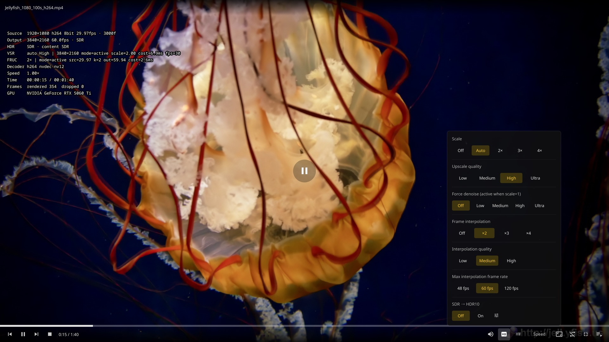

<p align="center">
  
</p>

# VSR Player

[](https://github.com/zhangmq/vsr-player/releases)
[](LICENSE)

Linux 桌面实时 AI 视频处理播放器，直接调用 **NVIDIA Video Effects SDK**：超分 + 降噪、插帧，以及 10-bit HDR 通路（HDR10 上屏、SDR→HDR10 上变换）。基于 **libmpv**——解封装、解码、音视频同步、VO 渲染全部交给 mpv；前端是 Qt 6 + QML，与 mpv 共享 Vulkan 设备。

> NVIDIA 的驱动级 RTX VSR 在 Linux 上没有接口。Video Effects SDK 提供了同一批模型和 Linux 运行时，所以本项目在播放器里直接调用它的 C API。这不是一条"合理"的路线——这类处理本该在驱动或合成器层——它只是驱动级路径出现之前的变通方案。

## 能做什么

- **AI 超分 + 降噪** — 实时 2×/3×/4×（`vf_vsr`），降噪在 scale=1 时也能单独生效
- **AI 插帧** — VFX `VideoFrameGeneration` ×2/×3/×4，质量档可热切换（`vf_vfg`）
- **10-bit / HDR 全链** — RGB10A2 贯通整条链；HDR 内容自动切 HDR10 上屏；SDR→HDR10 上变换为 opt-in（`vf_truehdr`）
- **XR 眼镜 3D 播放**（核心能力）— 3D 视频（左右或上下并排）直接在眼镜的 3D 模式下全屏播放，桌面保留控制窗口
- **2D 输出** — 只看 3D 片源的一只眼，按正常画幅满屏播放，且超分按单眼算（`vf_eye`）
- **蓝光光盘** — `.iso`（或 BDMV 目录）在播放列表里是**一条条目**；盘上的 title 在右键菜单的
  **「标题」**面板里（`Title 2 · 1:48:26`，另有合成的 `Disc menu`），默认直接进盘自己的菜单
  （偏好 → 光盘 → 打开时进入菜单）。HDMV 与 BD-J 菜单都能用方向键、Enter/Esc、鼠标、`Ctrl+M`
  （根菜单）、`Ctrl+Shift+M`（弹出菜单）操作。BD-J 菜单需要 Java 运行时 + libbluray 的 BD-J jar，
  能做什么/不能做什么见 [wiki](https://github.com/zhangmq/vsr-player/wiki/Blu-ray-and-Playlists)。
  3D 蓝光（MVC）不在支持范围，需先离线转 SBS
- **进度条悬停缩略图** — 悬停进度条即预览该时间点的画面，带时间与章节名；本地文件与网络流都支持
- **日常播放** — NVDEC 硬解、Vulkan 渲染、自动隐藏 QML UI、播放列表、轨道与延迟控制、循环、倍速、截图、JSON IPC、独立 `mpv-vsr` CLI

## 处理链

```
demux → decode → [deint] → [hwup] → [eye] → [rot]
      → [vsr] → [truehdr] → [vfg] → VO (libmpv) → Qt 场景图
```

方括号里是本项目自己的滤镜，其余全部交给 mpv。顺序是**成本决策**而非口味问题：软解帧在链路最前端一次性上传到 CUDA；超分按**每源帧**只算一次，作用在小画面上；插帧放在最后，作用在已完成画面——排在插帧之后的任何一步都要按 ×2/×3/×4 计费。

## 最近新增

**0.7.3**

- **修复：拖动音量滑杆会让画面卡顿** —— 滑杆每移动一次就写一次配置，而每次写配置都会在 GUI 线程（同时也是渲染线程）上同步重写整个配置文件：1.5 MB 时实测 19 ms/次，7 KB 时约 6 ms/次；现在拖动期间完全不写盘。音量与 TrueHDR 参数改为交互结束时落盘。
- **配置文件从 1.5 MB 降到 7 KB** —— 轨道记忆（1.2 MB）搬到独立的 `track-memory.json`；遗留的 `playlist` 键（300 KB）迁移到已有的 m3u8 快照；不再把临时的 `edl://` / `memory://` 字幕 URL 存进去（单条 bilibili 记录就有 281 KB）。
- **修复：列表推进后"无法播放"卡片不消失** —— 空文件夹或打不开的文件会写入一个粘滞的失败状态，而下一条载入时本该清掉它的处理分支是死代码。现在任何一次成功载入都会清掉。
- **列表里的失败不再打断播放** —— mpv 打不开的条目在列表里标注（`（无法播放）` / `（空文件夹）`，灰度显示），是否继续由 mpv 决定；只有失败条目是列表唯一一条时才弹卡片，且正文用我们对 mpv 错误码的译文，不再显示 mpv 的英文串。
- **音量 OSD 不再跳位/闪烁** —— 百分比保持固定宽度（`5%` → `100%` 不再挤动图标与进度条）；UI 改为直接观察 mpv 的音量、不再自己维护一份，按住方向键不再重放旧值（实测同一段 4K 片源按住 5 秒：修复前 31 次回退，修复后 0 次）。

**0.7.2**

- **修复：系统更新后播放器无法启动** —— sndio 1.11.0 把库名从 `libsndio.so.7` 改成 `libsndio.so.9`，动态加载器在进入程序前就中止。`full` 包现在自带 `libsndio`。
- **依赖缺失的报错更清楚** —— 在既有的 `COMPONENTS.md` 版本表之外，包内新增 `lib/vsr-player/deps.manifest`（每个必需 SONAME 一行，含哪个二进制需要它、构建机路径）。`install.sh` 逐项校验，并把**所有**缺失项连同归属一起列出；旧版只打前 5 行原始加载器输出，文案也只提 FFmpeg/CUDA/Qt。

**0.7.1**

- **修复：首次切全屏后画面定格** —— 视频和音频照常走，画面却不再刷新，直到缩放窗口或退出全屏。原因是 Qt 6.12.0 在 Vulkan + Wayland 下的一处缺陷（上游 QTBUG-151831，6.12.1 修复）；本包随附修好的 Qt 库，只在你的系统 Qt 需要时才启用。
- **修复：关闭播放器后进程（终端）不退出** —— 同一驱动行为触发的另一处 Qt 6.12.0 缺陷（上游 QTBUG-150279，6.12.1 修复），本包一并随附。

**0.7.0**

- **进度条悬停缩略图** — 悬停进度条显示该时间点的缩略图，面板逻辑宽 192 px、按显示缩放比渲染，HiDPI 下不发糊。本地文件与网络流都支持（复用已解析好的地址与请求头，不跑第二次解析）；取帧失败由下一次悬停重试。可在右键菜单 **界面 → 缩略图** 关闭。
- **「关于」弹窗** — 右键菜单底部新增「关于」：图标、软件名、版本号、授权协议、可点开的仓库地址。
- **应用图标重做** — 透明背景、像素块过渡到锐利三角；启动器/任务栏显示的就是它，「关于」弹窗里也是同一份。

**0.6.0**

- **右键菜单成为控制中心** — 视频/音频/字幕轨道、网络流选择、字幕与音频延迟，与「画面处理」「3D」分组并列；整套菜单可用键盘操作。
- **键位表统一** — 所有快捷键定义在同一张表里，2D 播放、3D 演示与菜单导航不会再各自漂移。

## 截图

<p align="center">
  
</p>

**VSR 对比** —— 原始 720p（左）与同一帧 4× 超分（右）：

<p align="center">
  
  
</p>

## 快速开始

**源码构建**（推荐——二进制按构造匹配你的系统库）：

```bash
git clone https://github.com/zhangmq/vsr-player && cd vsr-player
# 先按 docs/third-party-setup.md 准备 third_party/
./scripts/build-from-source.sh
```

**预编译包** —— `standard` 是**薄包（约 13 MB）**：带播放器本体、libmpv、两个 Wayland 辅助模块、两个修补过的 Qt 库，以及机器可读的依赖清单；FFmpeg、光盘媒体栈、CUDA、libplacebo 与 **Qt ≥ 6.12** 全部来自系统（VFX 运行时在安装时下载）。系统满足不了清单时 `install.sh` 会直接失败，并指出缺哪个库、谁需要它：

```bash
tar -xJf vsr-player-<ver>-linux-x86_64.tar.xz
./install.sh                 # 装到 ~/.local，不需要 sudo
```

两种方式都会装上 **VSR Player** 启动器入口，可设为视频/音频默认打开方式。打包变体、手工构建与版本兼容性见 [wiki：安装](https://github.com/zhangmq/vsr-player/wiki/Installation)。

## 前置要求

| | 最低 | 说明 |
|---|---|---|
| GPU | RTX 20 系 | 超分需 RTX 20+；默认插帧后端需 **Ada/Blackwell**（冻结的 RIFE 源码构建需 Ampere+） |
| 驱动 | 570+ | Wayland 开箱可用 |
| VFX SDK | 1.3（`nvidia-vfx` 0.2.0.0） | `install.sh` 从 NVIDIA 官方索引获取，不进任何 Python 环境 |
| Qt | 6.12+ | 否则自行构建 `full` 变体 |

## 播放

```bash
vsr-player video.mkv            # 单个文件
vsr-player ~/Videos             # 目录 → 播放列表
vsr-player                      # 还原上次列表，按下播放才载入
```

| 键 | 作用 |
|---|---|
| `Space` | 播放 / 暂停 |
| `←` / `→` | 快退/快进 5 秒（`Shift` = 10 秒） |
| `↑` / `↓` | 音量 ±5% |
| `Ctrl+←` / `Ctrl+→` | 上一个 / 下一个条目 |
| `A` / `Shift+A` | 循环画面比例（正序 / 逆序） |
| `V` | 字幕开 / 关 |
| `,` / `.` | 单帧后退 / 前进 |
| `P` / `F` / `Tab` / `S` | 播放列表 · 全屏 · OSD · 截图 |
| `Delete` / `Shift+Delete` | 从列表移除当前条目 / 把文件移到回收站 |
| `Menu` / `F10` | 右键菜单（可用键盘操作） |
| `Ctrl+Q` | 退出 |
| `J` / `K` / `L` | 3D 或单眼模式：布局 · 眼序 · 全半 |

右键菜单里还有其余入口——轨道与网络流、字幕/音频延迟、**画面处理**（反交错、旋转）、3D 与**关于**。完整选项、JSON IPC 命令与独立 `mpv-vsr` CLI 见 [wiki：使用](https://github.com/zhangmq/vsr-player/wiki/Usage)。

## 文档

- **Wiki** — [安装](https://github.com/zhangmq/vsr-player/wiki/Installation) ·
  [使用](https://github.com/zhangmq/vsr-player/wiki/Usage) ·
  [视频处理](https://github.com/zhangmq/vsr-player/wiki/Video-Processing) ·
  [3D 与单眼输出](https://github.com/zhangmq/vsr-player/wiki/3D-and-Single-Eye) ·
  [蓝光与播放列表](https://github.com/zhangmq/vsr-player/wiki/Blu-ray-and-Playlists) ·
  [疑难排查](https://github.com/zhangmq/vsr-player/wiki/Troubleshooting) ·
  [开发](https://github.com/zhangmq/vsr-player/wiki/Development)
- [`docs/`](docs) — 工程记录与实测数据（HDR 管线、VFX SDK、TrueHDR、3D 转换……）
- [`docs/third-party-setup.md`](docs/third-party-setup.md) — 源码构建的 `third_party/` 准备

## 现状与范围

视频处理这一侧在设计范围内已经做完。其余部分——窗口外观、控件布局、热区行为、OSD 文案——是作者个人喜好而非规范，**看心情改**，本 README 不是路线图。

本项目在有限硬件上开发（单一 GPU 世代、少量测试样本），边角问题请有预期：崩溃、画质异常或卡死都可能出现在未覆盖的组合上。欢迎 issue 与 PR。仓库刻意对 AI 代理友好：代码、mpv 补丁覆盖层与 `docs/` 里的设计记录，足以让代理快速理解管线并定位问题。

## 许可

GPLv2+。项目编译了打过补丁的 mpv 并链接 libmpv，因此分发的二进制是 mpv 的衍生作品，以同一许可分发。NVIDIA Video Effects SDK 运行时是 NVIDIA 专有软件，不受本项目许可约束。详见 [LICENSE](LICENSE)。

---

[English](README.md)
