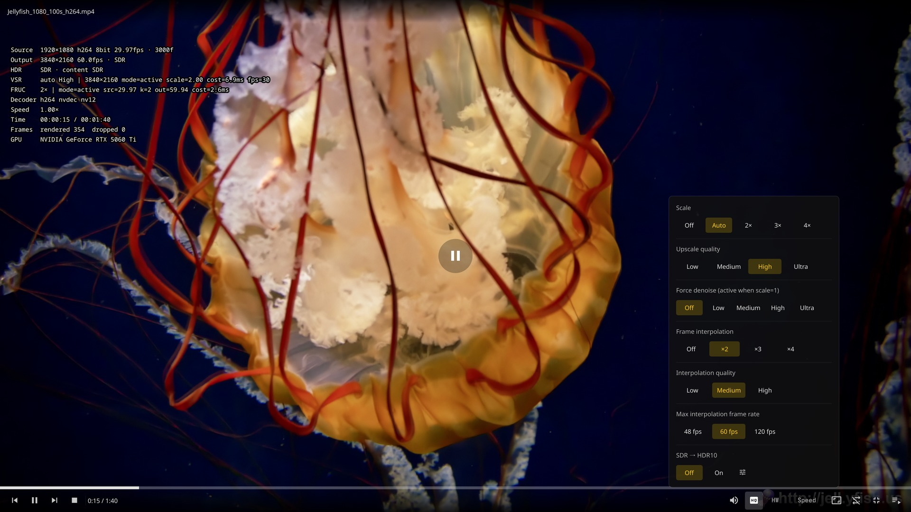
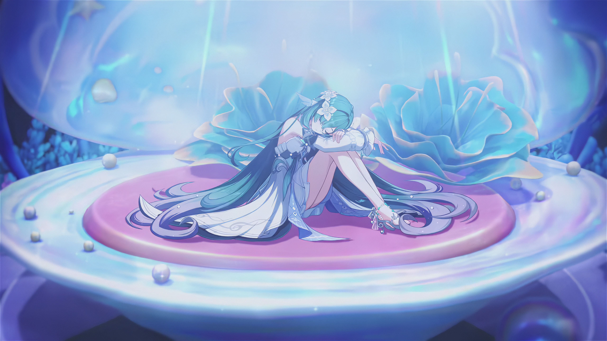

# VSR Player

> [English](Home) · 中文

Linux 上的实时 AI 视频处理播放器，直接构建在 **NVIDIA Video Effects SDK** 之上：神经网络超分与降噪、插帧，以及一条支持 HDR10 输出与 SDR→HDR10 上变换的 10-bit HDR 通路。底层基于 **libmpv**（解复用、解码、A/V 同步、VO 全部由 mpv 负责），前端是 Qt 6 / QML，并与 mpv 共享同一个 Vulkan 设备。

> NVIDIA 驱动层的 RTX Video Super Resolution 没有 Linux 接口。Video Effects SDK 以 Linux 运行时提供同一批模型，因此本项目直接从播放器里调用它的 C API。这是一种变通做法，并非这类处理应有的位置 —— 它存在的原因只是 Linux 上没有驱动层通路。

## 功能

- **AI 超分与降噪** —— 实时 2×/3×/4×（`vf_vsr`），降噪在 scale=1 时同样可用
- **AI 插帧** —— VFX `VideoFrameGeneration` ×2/×3/×4，画质档位可热切换（`vf_vfg`）
- **端到端 10-bit / HDR** —— 整条链走 RGB10A2，HDR 内容自动输出 HDR10，SDR→HDR10 上变换需显式开启（`vf_truehdr`）
- **XR 眼镜上的 3D** —— 把 3D 视频（左右并排或上下）以 3D 模式输出到 XR 眼镜：眼镜上显示全屏画面，控件留在桌面。其余功能（蓝光 ISO、2D 输出、旋转、播放列表命名）都是围绕它做的配套工作
- **2D 输出** —— 把 3D 片源的其中一只眼当作普通全画幅画面观看，VSR 按单眼分别处理（`vf_eye`）
- **蓝光 ISO** —— `.iso` 的行为与文件夹/m3u 类似：mpv 将其展开为多个标题，播放器显示标题名与时长
- **日常播放器** —— NVDEC 解码、Vulkan 渲染、自动隐藏的 QML 界面、播放列表、循环模式、倍速、截图、JSON IPC、独立的 `mpv-vsr` CLI

## 近期新增

### 0.8.0

- **基于 mpv 0.42.0 + 上游的光盘模型** —— 一张光盘是一个播放列表条目，其标题是 mpv 的 edition（菜单里的 **Title** 面板）。0.7.x 中每个标题各列一条 `bd://` 条目的播放列表不再可用；请重新打开 ISO。
- **修复：显存持续增长，直至 AI 引擎无法再加载**（实测 13.2 GB）—— TrueHDR 以前每次尺寸变化和 seek 都重建引擎；现在改为原地换图，并在 seek 之间保留引擎。
- **修复：插帧/超分/SDR→HDR10 静默失效**（滤镜编译了却没有注册，mpv 于是丢弃整条链）；现在被拒绝的链会记录日志。
- **修复：反交错「force → auto」切换后仍然生效**，导致逐行片源仍按场率处理、×2 插帧长期超出上限。
- **画质快捷键** `Ctrl+1…4`、`Ctrl+0`、`Ctrl+Shift+1…4`、`Ctrl+Shift+0`、`Ctrl+H`，每次变更都弹出一条瞬态提示（`Ctrl+0` 不再重置字幕延迟 —— 那是 `Ctrl+Alt+Z`）。
- **OSD 拆分为 Source / Output / TrueHDR 三行**，所有 VFX 状态段都带上耗时。
- **右键菜单可隐藏 3D 区块**（Preferences → Interface），菜单高度超过窗口时**可滚动**。
- **显存不足与驱动错误改为独立的提示卡**；面向没有 NVIDIA GPU 的机器提供 `--no-rtx` 源码构建。

### 0.7.3

- **修复：拖动音量滑块会造成画面卡顿** —— 滑块每次移动都保存设置，而每次写设置都会在 GUI 线程（同时也是渲染线程）上同步重写整个配置文件：实测 1.5 MB 的文件每次写入 19 ms，7 KB 的文件约 6 ms；现在拖动过程中不再写入。音量（以及 TrueHDR 的滑块）在交互结束时才持久化。
- **配置文件从 1.5 MB 缩减到 7 KB** —— 轨道记忆（1.2 MB）移到独立的 `track-memory.json`；遗留的 `playlist` 键（300 KB）迁移到已有的 m3u8 快照；临时的 `edl://` / `memory://` 字幕 URL 不再保存（仅 bilibili 的一条就占 281 KB）。
- **修复：播放列表已经切走，「无法播放」提示卡却仍留在屏幕上** —— 空文件夹或无法读取的文件会置上一个粘滞的失败状态，而本该清除它的处理分支藏在一个永远走不到的重复分支之后。现在任何一次成功加载都会清除该状态。
- **播放列表失败不再打断播放** —— mpv 打不开的条目会在列表中标出（`(unplayable)` / `(empty folder)`，置灰）；是否继续由 mpv 决定。只有当失败条目是唯一一条时才出现提示卡，且文案是我们自己对 mpv 错误码的翻译，而不是 mpv 的英文原文。
- **音量 OSD 不再位移或闪烁** —— 百分比标签保持固定宽度，`5%` → `100%` 时图标与进度条不再移动；界面现在直接观察 mpv 的音量，不再自己维护副本，长按音量键不会再回放旧值（实测：以前按住 5 s 出现 31 次回退，现在为 0）。

### 0.7.2

- **修复：系统更新后播放器无法启动** —— sndio 1.11.0 重命名了库文件（`libsndio.so.7` → `libsndio.so.9`），动态加载器在播放器启动之前就中止了。`full` 包现在自带 `libsndio`。
- **依赖失败信息更清晰** —— 除已有的 `COMPONENTS.md` 版本表外，包内新增 `lib/vsr-player/deps.manifest`（每个必需的 SONAME 一行，注明哪个二进制需要它以及构建机上的路径）。`install.sh` 会校验该清单，列出*每一个*缺失条目及其所属者，而不是像以前那样只给五行原始加载器报错、文字里只提到 FFmpeg/CUDA/Qt。

### 0.7.1

- **修复：首次切换全屏后画面冻结** —— 视频和音频仍在继续，但画面停止更新，直到调整窗口大小或退出全屏。根因是 Qt 6.12.0 在 Vulkan + Wayland 路径上的缺陷（上游 QTBUG-151831，已在 6.12.1 修复）。包内现在附带修复后的 Qt 库，并且只在宿主 Qt 需要时才启用。
- **修复：关闭播放器后进程与终端仍然残留** —— 这是同一驱动行为触发的第二个 Qt 6.12.0 缺陷（上游 QTBUG-150279，已在 6.12.1 修复）；包内也带上了该修复。
- standard 包从约 7 MB 增大到约 13 MB，因为要携带这两个 Qt 库；只有当宿主 Qt 为 6.12.x 且低于 6.12.1 时才安装它们，一旦系统装上 Qt 6.12.1 或更新版本就自动跳过。
  （0.8.0 起包体又回到约 7 MB：构建机已是 Qt 6.12.1，不再需要携带这两个库 —— 如果你的发行版
  仍在 Qt 6.12.0，请用 `full` 包或自行源码构建。）

### 0.7.0

- **悬停缩略图** —— 鼠标悬停在进度条上会显示该位置的缩略图（本地文件与网络流都支持），带时间，片源有章节时还显示章节名。面板宽 192 逻辑像素，按显示缩放渲染，因此在 HiDPI 下依然清晰；抓取失败会在下次悬停时重试。可在右键菜单中关闭（**Interface → Thumbnails**）。
- **About** —— 右键菜单以 **About** 结尾：图标、程序名、版本、许可证以及可点击的仓库链接。
- **新应用图标** —— 透明背景，像素方块逐渐汇聚成一个锐利的三角形，已安装进桌面图标主题。

### 0.6.0

- **右键菜单成为控制中心** —— 视频/音频/字幕轨道、网络流选择（`yt-dlp` 格式）、字幕延迟与音频延迟，以及画面处理和 3D 区块；可完全用键盘操作（`↑`/`↓`、`Home`/`End`、`→`/`←`、`Enter`、`Esc`）。
- **统一的键位表** —— 所有快捷键都定义在同一张表里，2D 播放、3D 演示与菜单导航因此不会各自漂移。
- **3D 会话修复** —— 从任一窗口退出、菜单归属、单眼宽高比 OSD，以及屏幕选择器中的键盘控制。

### 0.5.0

| 特性 | 说明 |
|---|---|
| **2D 输出** | 新增 `vf_eye` 滤镜，在超分*之前*从 SBS/TAB 帧中裁出一只眼，让 VSR 作用在单眼画面上。宽度/高度只有一半的片源会被拉伸回自然尺寸，使宽高比覆盖、旋转与自动缩放的表现与普通 2D 一致 |
| **3D 菜单区块** | 右键菜单新增一个小的 **3D** 分组，含三个互相独立的条目：**Output mode**（Off / 3D glasses / 2D output）、**Source layout**（左右并排或上下，full 或 half）、**Output option**（左眼或右眼） |
| **宽高比与 mpv 对齐** | 底栏弹出面板与新增的 `A` 热键循环 mpv 自带的那份列表：`16:9`、`4:3`、`2.35:1`、`no`。3D 下该值表示*单眼*宽高比，会在传给 mpv 之前换算 |
| **画面处理分组** | 反交错与旋转现在归到同一个菜单标题下 |
| **蓝光标题命名** | 播放列表条目显示 `Title 6 · 1:18:30`，而不是 ISO 文件名，重启后同样如此 |
| **播放列表快照** | 播放列表持久化为 m3u8 文件，并通过 mpv 自己的播放列表解析器恢复，条目名因此能跨重启保留 |
| **启动保持 idle** | 无参数启动只恢复列表 —— 在按下播放之前不解码、不加载引擎、不占用显存 |

## 截图



**VSR 对比** —— 原始 720p，以及同一帧 4× 之后的效果：




## 快速开始

**源码构建**（推荐 —— 生成的二进制与你的系统库天然匹配）：

```bash
git clone https://github.com/zhangmq/vsr-player && cd vsr-player
# prepare third_party/ first: see docs/third-party-setup.md
./scripts/build-from-source.sh
```

**预编译包** —— `standard` 是薄包：它只携带播放器、libmpv、Wayland 辅助模块、打过补丁的 Qt 库和一份依赖清单；FFmpeg、媒体栈、CUDA、libplacebo 以及 Qt ≥ 6.12 来自系统，VFX 在安装时下载：

```bash
tar -xJf vsr-player-<ver>-linux-x86_64.tar.xz
./install.sh                 # installs into ~/.local, no sudo
```

两种方式都会安装一个 **VSR Player** 启动器条目，并可设为默认的视频/音频打开方式。

## 运行要求

| | 最低要求 | 说明 |
|---|---|---|
| GPU | RTX 20 系列 | VSR 需要 RTX 20 及以上；默认插帧后端需要 **Ada/Blackwell** |
| Driver | 570+ | Wayland 开箱即用 |
| VFX SDK | 1.3（`nvidia-vfx` 0.2.0.0） | `install.sh` 从 NVIDIA 的索引下载，绝不装进 Python 环境 |
| Qt | 6.12+ | 若发行版自带的 Qt 较旧，请构建 `full` 变体 |

## 播放

```bash
vsr-player video.mkv            # file
vsr-player ~/Videos             # directory → playlist
vsr-player                      # restores the last playlist, loads nothing until Play
```

| 按键 | 操作 |
|---|---|
| `Space` | 播放 / 暂停 |
| `←` / `→` | 快退 / 快进 5 s（按 `Shift` 为 ±10 s） |
| `↑` / `↓` | 音量 ±5 % |
| `Ctrl+←` / `Ctrl+→` | 上一个 / 下一个播放列表条目 |
| `A` / `Shift+A` | 循环切换宽高比（`16:9` → `4:3` → `2.35:1` → `no`） |
| `P` | 播放列表面板 |
| `F` | 全屏 |
| `Tab` | OSD 信息叠加层 |
| `S` | 截图 |
| `Menu` / `Shift+F10` / `F10` | 右键菜单（可用键盘导航） |
| `Ctrl+Q` | 退出 |
| `3D` 模式：`J` / `K` / `L` | 布局（SBS/TAB）· 眼序 · full/half |

其余功能都在右键菜单里 —— 轨道与网络流、字幕/音频延迟、画面处理、3D、About —— 悬停进度条还能看到缩略图。完整的选项列表、JSON IPC 命令与独立的 `mpv-vsr` CLI 见 wiki。

## 文档

- **Wiki** —— 用户指南：安装、使用、3D 与单眼输出、蓝光、故障排查
- [`docs/third-party-setup.md`](https://github.com/zhangmq/vsr-player/blob/master/docs/third-party-setup.md) —— 准备 `third_party/`
- [`docs/`](https://github.com/zhangmq/vsr-player/tree/master/docs) —— 工程记录与实测数据（HDR 通路、VFX SDK、TrueHDR、3D 转换……）

## 状态与范围

视频处理部分在其既定范围内功能已完备。其余一切 —— 窗口外观、控件布局、悬停行为、OSD 文案 —— 反映的是作者的偏好而非规格，随时可能变化；本 README 不是路线图。

开发只在单一 GPU 代际和少量测试文件上进行，因此存在毛边是正常的：这里从未出现过的崩溃、花屏或卡死，在其他组合上仍可能发生。欢迎提交 bug 报告与 pull request。仓库刻意对 agent 友好 —— AI 编码 agent 可以阅读管线、mpv 补丁 overlay 以及 `docs/` 里的设计记录，从而快速定位问题。

## 许可证

GPLv2+。本项目编译了打过补丁的 mpv 并链接 libmpv，因此分发出去的二进制是 mpv 的衍生作品，须以同一许可证分发。NVIDIA Video Effects SDK 运行时是 NVIDIA 的专有软件，不在本项目许可证的覆盖范围内。
