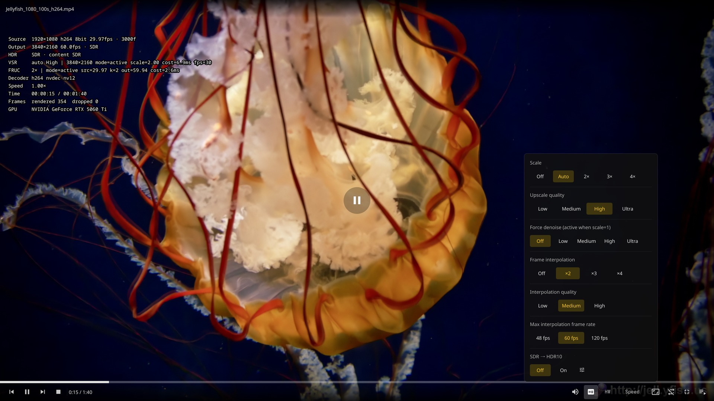
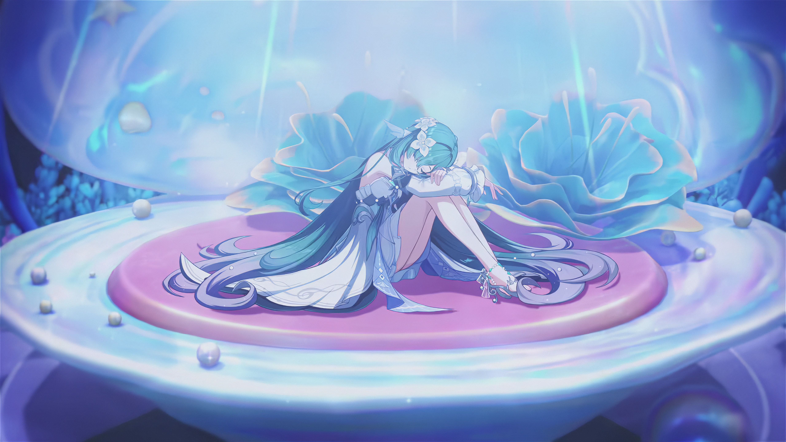

# VSR Player

Real-time AI video processing player for Linux, built directly on the **NVIDIA Video
Effects SDK**: neural super-resolution + denoising, frame interpolation, and a 10-bit
HDR pipeline with HDR10 output and SDR→HDR10 upconversion. Built on **libmpv** (demux,
decode, A/V sync, VO all handled by mpv) with a Qt 6 / QML frontend on a Vulkan device
shared with mpv.

> NVIDIA's driver-level RTX Video Super Resolution has no Linux interface. The Video
> Effects SDK exposes the same models with a Linux runtime, so this project calls its C
> API directly from a player. That is a workaround, not the ideal place for this kind of
> processing — it exists because there is no driver-level path on Linux.

## What it does

- **AI super-resolution + denoise** — real-time 2×/3×/4× (`vf_vsr`), denoise also works at scale=1
- **AI frame interpolation** — VFX `VideoFrameGeneration` ×2/×3/×4 with hot-switchable quality (`vf_vfg`)
- **10-bit / HDR end to end** — RGB10A2 through the whole chain, automatic HDR10 output for HDR content, opt-in SDR→HDR10 upconversion (`vf_truehdr`)
- **3D on XR glasses** — play 3D videos (side-by-side or top-and-bottom) on XR glasses in 3D mode: fullscreen picture on the glasses, controls stay on the desktop. Everything else in this release (Blu-ray ISO, 2D output, rotation, playlist naming) is supporting work around it
- **2D output** — watch one eye of a 3D source as a normal full-frame picture, with VSR applied per eye (`vf_eye`)
- **Blu-ray ISO** — `.iso` behaves like a folder/m3u: mpv expands it into titles, the player shows them with names and durations
- **Everyday player** — NVDEC decode, Vulkan rendering, auto-hide QML UI, playlist, loop modes, speed, screenshots, JSON IPC, standalone `mpv-vsr` CLI

## Recent additions

### 0.7.3

- **Fixed: dragging the volume slider stuttered the video** — the slider saved the
  setting on every movement, and each settings write rewrites the whole configuration
  file synchronously on the GUI thread (which is also the render thread): measured
  19 ms per write with the 1.5 MB file, ~6 ms with the 7 KB one, and now nothing is
  written while dragging. Volume (and the TrueHDR sliders) persist when the interaction
  ends.
- **Configuration file shrank from 1.5 MB to 7 KB** — track memory (1.2 MB) moved to its
  own `track-memory.json`; the legacy `playlist` key (300 KB) was migrated to the
  existing m3u8 snapshot; temporary `edl://` / `memory://` subtitle URLs are no longer
  stored (a single bilibili entry was 281 KB on its own).
- **Fixed: the "cannot play" card stayed on screen after the playlist moved on** — an
  empty folder or an unreadable file set a sticky failure state, and the handler that
  should have cleared it sat behind an unreachable duplicate branch. Any successful load
  now clears it.
- **Playlist failures no longer interrupt playback** — entries mpv could not open are
  marked in the list (`(unplayable)` / `(empty folder)`, dimmed); mpv decides whether to
  continue. The card appears only when the failed item is the sole entry, and its text is
  our own translation of the mpv error code instead of mpv's English string.
- **Volume OSD no longer shifts or flickers** — the percentage label keeps a fixed width,
  so `5%` → `100%` no longer moves the icon and the bar; and the UI now observes mpv's
  volume directly instead of keeping its own copy, so holding the volume keys no longer
  replays older values (measured: 31 backwards steps in a 5 s hold before, 0 after).

### 0.7.2

- **Fixed: the player would not start after a system update** — sndio 1.11.0 renamed its
  library (`libsndio.so.7` → `libsndio.so.9`), so the dynamic loader aborted before the
  player could run. The `full` package now carries `libsndio`.
- **Clearer dependency failures** — in addition to the existing `COMPONENTS.md` version
  table, the package ships `lib/vsr-player/deps.manifest` (one line per required SONAME,
  which binary needs it, and the build-machine path). `install.sh` verifies it and lists
  *every* missing entry with its owner, instead of the previous five raw loader lines whose
  text only mentioned FFmpeg/CUDA/Qt.

### 0.7.1

- **Fixed: the picture freezes on the first fullscreen switch** — video and audio keep
  going, but the picture stops updating until the window is resized or fullscreen is
  left. Root cause: a Qt 6.12.0 defect on the Vulkan + Wayland path (upstream
  QTBUG-151831, fixed in 6.12.1). The package now ships the fixed Qt library and only
  activates it when the host Qt needs it.
- **Fixed: closing the player left the process and the terminal behind** — a second Qt
  6.12.0 defect triggered by the same driver behaviour (upstream QTBUG-150279, fixed in
  6.12.1); the package ships that fix too.
- The standard package grows from ~7 MB to ~13 MB because it carries those two Qt
  libraries; they are installed only when the host Qt is 6.12.x and older than 6.12.1,
  and are skipped automatically once Qt 6.12.1 or newer is installed.

### 0.7.0

- **Hover thumbnails** — hovering the progress bar shows a thumbnail of that position (local
  files and network streams alike), with the time and, when the source has chapters, the
  chapter name. The panel is 192 logical pixels wide and rendered at the display scale, so it
  stays sharp on HiDPI; a failed fetch is retried on the next hover. Switch it off in the
  right-click menu (**Interface → Thumbnails**).
- **About** — the right-click menu ends with **About**: icon, program name, version, licence
  and a clickable repository link.
- **New application icon** — transparent background, pixel tiles fading into a sharp
  triangle, installed into the desktop icon theme.

### 0.6.0

- **The right-click menu is the control centre** — video/audio/subtitle tracks, network
  stream selection (`yt-dlp` formats), subtitle and audio delay, plus the picture-processing
  and 3D blocks; fully keyboard-driven (`↑`/`↓`, `Home`/`End`, `→`/`←`, `Enter`, `Esc`).
- **One key map** — every shortcut is defined in a single table, so 2D playback, 3D
  presentation and menu navigation cannot drift apart.
- **3D session fixes** — quitting from either window, menu ownership, per-eye aspect OSD and
  keyboard control in the screen picker.

### 0.5.0

| Feature | Notes |
|---|---|
| **2D output** | New `vf_eye` filter cuts one eye out of an SBS/TAB frame *before* upscaling, so VSR runs on the per-eye picture. Half-width/height sources are stretched back to natural size so aspect override, rotation and auto-scaling behave like ordinary 2D |
| **3D menu block** | Right-click menu gained a small **3D** group with three independent entries: **Output mode** (Off / 3D glasses / 2D output), **Source layout** (side by side or top and bottom, full or half), **Output option** (left or right eye) |
| **Aspect ratio aligned with mpv** | The bottom-bar popup and the new `A` hotkey cycle the same list mpv ships with: `16:9`, `4:3`, `2.35:1`, `no`. In 3D the value means *per-eye* aspect and is converted before it reaches mpv |
| **Picture processing group** | Deinterlace and rotation are now grouped under one menu header |
| **Blu-ray title naming** | Playlist entries show `Title 6 · 1:18:30` instead of the ISO file name, including after a restart |
| **Playlist snapshot** | The playlist is persisted as an m3u8 file and restored through mpv's own playlist parser, so entry names survive restarts |
| **Startup stays idle** | Launching with no arguments only restores the list — no decode, no engine load, no VRAM use until you press Play |

## Screenshots



**VSR comparison** — original 720p, and the same frame at 4×:




## Quick start

**Source build** (recommended — the binaries match your system libraries by construction):

```bash
git clone https://github.com/zhangmq/vsr-player && cd vsr-player
# prepare third_party/ first: see docs/third-party-setup.md
./scripts/build-from-source.sh
```

**Prebuilt tarball** — `standard` is a thin package: it ships the players, libmpv, the
Wayland helper modules, the patched Qt libraries and a dependency manifest; FFmpeg, the
media stack, CUDA, libplacebo and Qt ≥ 6.12 come from the system, VFX is fetched at install
time:

```bash
tar -xJf vsr-player-<ver>-linux-x86_64.tar.xz
./install.sh                 # installs into ~/.local, no sudo
```

Both paths install a **VSR Player** launcher entry and can be used as the default
video/audio handler.

## Requirements

| | Minimum | Notes |
|---|---|---|
| GPU | RTX 20-series | VSR needs RTX 20+; the default interpolation backend needs **Ada/Blackwell** |
| Driver | 570+ | Wayland works out of the box |
| VFX SDK | 1.3 (`nvidia-vfx` 0.2.0.0) | `install.sh` downloads it from NVIDIA's index, never into a Python env |
| Qt | 6.12+ | Build the `full` variant if your distro ships older Qt |

## Playing

```bash
vsr-player video.mkv            # file
vsr-player ~/Videos             # directory → playlist
vsr-player                      # restores the last playlist, loads nothing until Play
```

| Key | Action |
|---|---|
| `Space` | Play / pause |
| `←` / `→` | Seek ∓5 s (`Shift` = ±10 s) |
| `↑` / `↓` | Volume ±5 % |
| `Ctrl+←` / `Ctrl+→` | Previous / next playlist entry |
| `A` / `Shift+A` | Cycle aspect (`16:9` → `4:3` → `2.35:1` → `no`) |
| `P` | Playlist panel |
| `F` | Fullscreen |
| `Tab` | OSD info overlay |
| `S` | Screenshot |
| `Menu` / `F10` | Right-click menu (keyboard-navigable) |
| `Ctrl+Q` | Quit |
| `3D` mode: `J` / `K` / `L` | Layout (SBS/TAB) · eye order · full/half |

The right-click menu holds the rest — tracks and network streams, subtitle/audio delay,
picture processing, 3D, About — and hovering the progress bar shows thumbnails. Full option
list, JSON IPC commands and the standalone `mpv-vsr` CLI: see the wiki.

## Documentation

- **Wiki** — user guides: installation, usage, 3D and single-eye output, Blu-ray, troubleshooting
- [`docs/third-party-setup.md`](https://github.com/zhangmq/vsr-player/blob/master/docs/third-party-setup.md) — preparing `third_party/`
- [`docs/`](https://github.com/zhangmq/vsr-player/tree/master/docs) — engineering notes and measurements (HDR pipeline, VFX SDK, TrueHDR, 3D conversion, …)

## Status & scope

The video-processing side is feature-complete for its intended scope. Everything else —
window chrome, control layout, hover behaviour, OSD wording — reflects the author's
preference rather than a specification and may change at any time; this README is not a
roadmap.

Development happens on a single GPU generation and a small set of test files, so rough
edges are expected: crashes, artifacts or hangs that were never seen here can still
happen on other combinations. Bug reports and pull requests are welcome. The repository
is deliberately agent-friendly — an AI coding agent can read the pipeline, the mpv patch
overlay and the design records in `docs/` to locate issues quickly.

## License

GPLv2+. The project compiles a patched mpv and links against libmpv, so distributed
binaries are derivative works of mpv and are distributed under the same license. The
NVIDIA Video Effects SDK runtime is NVIDIA proprietary software and is not covered by
this project's license.
